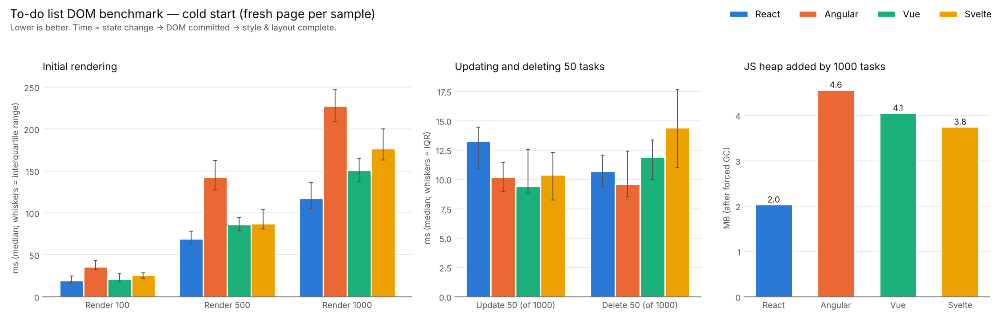

# DOM benchmark: React vs Angular vs Vue vs Svelte

The same to-do list application (add, view, edit, delete tasks with a name and priority) built in
four front-end frameworks, plus one shared, framework-agnostic harness that measures how long each
framework takes to **render 100 / 500 / 1000 tasks**, **update 50 tasks** and **delete 50 tasks**,
and how much **memory** the list uses.

- **Results:** [`results/RESULTS.md`](results/RESULTS.md) (full tables, three test conditions, raw data)
- **Reflection report:** [`REFLECTION.md`](REFLECTION.md)
- **Optimisation experiments:** [`results/EXPERIMENTS.md`](results/EXPERIMENTS.md)

## Results at a glance

Median *script + layout* time in milliseconds (state change → framework updates the DOM → browser
finishes style and layout). Cold start = a fresh page for every sample, 25 samples per cell.
**Bold** = fastest.

| Operation | React 19.3 | Angular 21.2 | Vue 3.5 | Svelte 5.57 |
|---|---:|---:|---:|---:|
| Render 100 tasks | **19.2** | 36.0 | 20.8 | 25.5 |
| Render 500 tasks | **69.3** | 142.9 | 86.2 | 87.0 |
| Render 1000 tasks | **117.6** | 227.7 | 150.8 | 177.0 |
| Update 50 tasks (of 1000) | 13.3 | 10.2 | **9.4** | 10.4 |
| Delete 50 tasks (of 1000) | 10.7 | **9.6** | 11.9 | 14.4 |
| JS heap added by 1000 tasks | **2.0 MB** | 4.6 MB | 4.1 MB | 3.8 MB |
| JS bundle (gzip) | 68.4 KB | 54.2 KB | 27.2 KB | **17.3 KB** |



[`results/RESULTS.md`](results/RESULTS.md) also has the **warm / steady-state** run (5 warm-up rounds
before each measurement), a **4× CPU-throttled** run approximating a mid-range phone, a breakdown of
script vs layout time, and DOM node counts. In short: React renders fastest in all three conditions;
update times are close for all four (Vue fastest cold, React warm, Svelte under 4× throttling);
React and Angular delete fastest.

## Repository layout

```
react-todo/      React 19  — components + useState, React.memo rows, flushSync for the benchmark
angular-todo/    Angular 21 — *ngFor (trackBy), *ngIf, [(ngModel)] two-way binding, signals, OnPush rows
vue-todo/        Vue 3     — reactive ref, v-for / v-if / v-model directives, TaskRow child component
svelte-todo/     Svelte 5  — compiled components, $state runes, keyed {#each}, bind:value
shared/          bench-harness.js + todo.css — copied into every app so all four are measured identically
bench/           Playwright scripts: functional_test.py, run_benchmarks.py, make_report.py
results/         JSON raw data, RESULTS.md, EXPERIMENTS.md, charts, DevTools traces
```

Every app renders the same markup (`<ul id="task-list"><li class="task">` with a priority badge, the
task name, and Edit / Delete buttons) and loads the same stylesheet, so the browser's layout work is
identical and only the framework differs.

## How the measurements work

1. **One harness for all four.** `shared/bench-harness.js` generates identical, seeded task data,
   times each operation and *verifies the DOM afterwards* (row count, edited text, deleted ids) so a
   framework can't look fast by skipping work.
2. **Each app plugs in a small adapter** that drives its own state management and forces the DOM
   commit to happen synchronously, so the stopwatch stops at the right moment:
   React `flushSync`, Vue `await nextTick()`, Svelte `flushSync()`, Angular `ApplicationRef.tick()`.
3. **Three timings per operation:** *script* (framework JS + DOM API calls), *layout* (a forced style +
   layout pass), and *to next frame* (includes paint and frame jitter). The tables use script + layout.
4. **Automated runs in Chrome.** `bench/run_benchmarks.py` drives headless Chromium with Playwright,
   loads each production build in a fresh browser context per sample, interleaves frameworks in random
   order, and reports medians. Memory comes from the Chrome DevTools Protocol (`Performance.getMetrics`
   after forced GC); CPU throttling uses DevTools' `Emulation.setCPUThrottlingRate`. One DevTools
   trace per framework is saved in `results/traces/` (open in Chrome DevTools → Performance → Load profile).
5. **Update and delete** run on a list of 1000 tasks and touch 50 tasks spread evenly across it
   (every 20th task), each as a single state change.

You can also benchmark by hand: every app has a dark toolbar at the top with *Render 100 / 500 / 1000*,
*Update 50*, *Delete 50* and *Clear* buttons that print timings on the page and to the console, so you
can record the same operations in the Chrome DevTools Performance panel.

## Running it yourself

Requirements: Node 22+, Python 3.10+ with Playwright (`pip install playwright matplotlib && playwright install chromium`).

```bash
npm run install:all   # install each app's dependencies
npm run build:all     # sync shared files, then production-build all four apps
npm test              # functional test: add / view / edit / cancel / delete in every app
npm run bench         # cold, warm and 4× throttled runs (~20 min) -> results/*.json
npm run report        # tables + charts -> results/RESULTS.md, results/*.png
```

To develop one app: `cd react-todo && npm run dev` (or `vue-todo`, `svelte-todo`; for Angular `cd angular-todo && npx ng serve`).

## Notes and limitations

- Absolute numbers depend on the machine (these came from a 2-core Linux VM, headless Chromium 141);
  compare the frameworks with each other, not with other benchmarks.
- Angular 21 is used rather than 22 because the Angular 22 CLI needs Node 22.22.3+. The brief asks for
  `*ngFor` / `*ngIf`, so those are used; Angular's newer `@for` / `@if` block syntax is the modern equivalent.
- Update and delete differences at normal CPU speed are small (a few milliseconds) and their
  interquartile ranges overlap; render differences are large and consistent across all three runs.
