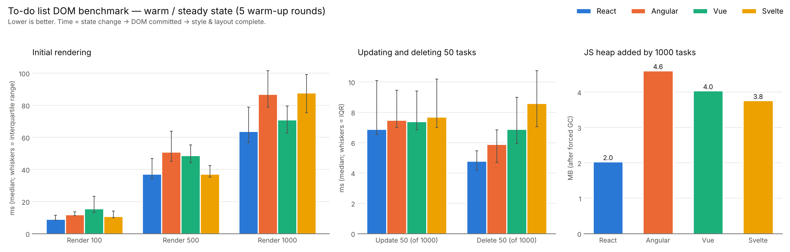

# Benchmark results

Generated by `bench/make_report.py` from the JSON files in this folder. All times are **medians in milliseconds** for *script + layout* (state change → framework updates the DOM → browser finishes style recalculation and layout). **Bold** = fastest.

## 1. Cold start — the headline numbers

Every sample loads a fresh page and performs the operation once, like a real user's first interaction.

Chromium 141.0.7390.37 (headless, Playwright) · Linux x86_64 · CPU throttling 1× · cold (fresh page per sample) · 25 samples per cell · React 19.3.0, Angular 21.2.25, Vue 3.5.43, Svelte 5.57.2 · run 2026-10-08T15:59:14+00:00

| Operation | React | Angular | Vue | Svelte | Fastest |
|---|---:|---:|---:|---:|---|
| Render 100 | **19.2** | 36.0 | 20.8 | 25.5 | React |
| Render 500 | **69.3** | 142.9 | 86.2 | 87.0 | React |
| Render 1000 | **117.6** | 227.7 | 150.8 | 177.0 | React |
| Update 50 (of 1000) | 13.3 | 10.2 | **9.4** | 10.4 | Vue |
| Delete 50 (of 1000) | 10.7 | **9.6** | 11.9 | 14.4 | Angular |

Relative to the fastest framework (1.00× = fastest):

| Operation | React | Angular | Vue | Svelte |
|---|---:|---:|---:|---:|
| Render 100 | 1.00× | 1.87× | 1.08× | 1.33× |
| Render 500 | 1.00× | 2.06× | 1.24× | 1.26× |
| Render 1000 | 1.00× | 1.94× | 1.28× | 1.51× |
| Update 50 (of 1000) | 1.41× | 1.09× | 1.00× | 1.11× |
| Delete 50 (of 1000) | 1.11× | 1.00× | 1.24× | 1.50× |

### Where the time goes — rendering 1000 tasks (cold)

| Framework | Script (ms) | Style + layout (ms) | Script + layout (ms) | To next frame (ms) |
|---|---:|---:|---:|---:|
| React | 43.6 | 73.5 | 117.6 | 137.3 |
| Angular | 143.4 | 87.0 | 227.7 | 246.4 |
| Vue | 81.0 | 66.3 | 150.8 | 166.8 |
| Svelte | 97.0 | 78.3 | 177.0 | 194.3 |

### Memory and bundle size

| Framework | Heap, empty app (MB) | Heap, 1000 tasks (MB) | Heap added by 1000 tasks (MB) | DOM nodes, 1000 tasks | JS bundle (KB, gzip) |
|---|---:|---:|---:|---:|---:|
| React | 1.49 | 3.53 | 2.03 | 9,091 | 68.4 |
| Angular | 2.05 | 6.62 | 4.57 | 11,096 | 54.2 |
| Vue | 1.30 | 5.36 | 4.06 | 9,094 | 27.2 |
| Svelte | 1.22 | 4.98 | 3.75 | 14,153 | 17.3 |

Heap measured through the Chrome DevTools Protocol (`Performance.getMetrics`) after two forced garbage collections, median of 5 page loads.

## 2. Warm (steady state)

Same operations, but each sample first repeats the operation 5 times on the same page so V8 has optimised every code path — this is closer to the methodology of the well-known js-framework-benchmark.

Chromium 141.0.7390.37 (headless, Playwright) · Linux x86_64 · CPU throttling 1× · warm (5 warm-up rounds) · 25 samples per cell · React 19.3.0, Angular 21.2.25, Vue 3.5.43, Svelte 5.57.2 · run 2026-10-08T16:06:51+00:00

| Operation | React | Angular | Vue | Svelte | Fastest |
|---|---:|---:|---:|---:|---|
| Render 100 | **9.1** | 11.9 | 15.6 | 10.9 | React |
| Render 500 | **37.2** | 50.9 | 48.8 | **37.2** | React = Svelte |
| Render 1000 | **63.9** | 87.0 | 71.1 | 87.7 | React |
| Update 50 (of 1000) | **6.9** | 7.5 | 7.4 | 7.7 | React |
| Delete 50 (of 1000) | **4.8** | 5.9 | 6.9 | 8.6 | React |

Relative to the fastest:

| Operation | React | Angular | Vue | Svelte |
|---|---:|---:|---:|---:|
| Render 100 | 1.00× | 1.31× | 1.71× | 1.20× |
| Render 500 | 1.00× | 1.37× | 1.31× | 1.00× |
| Render 1000 | 1.00× | 1.36× | 1.11× | 1.37× |
| Update 50 (of 1000) | 1.00× | 1.09× | 1.07× | 1.12× |
| Delete 50 (of 1000) | 1.00× | 1.23× | 1.44× | 1.79× |

## 3. Cold start on a slow device (4× CPU throttling)

Chrome DevTools CPU throttling (`Emulation.setCPUThrottlingRate`) approximates a mid-range phone.

Chromium 141.0.7390.37 (headless, Playwright) · Linux x86_64 · CPU throttling 4× · cold (fresh page per sample) · 10 samples per cell · React 19.3.0, Angular 21.2.25, Vue 3.5.43, Svelte 5.57.2 · run 2026-10-08T16:10:47+00:00

| Operation | React | Angular | Vue | Svelte | Fastest |
|---|---:|---:|---:|---:|---|
| Render 100 | **72.8** | 149.2 | 127.4 | 117.5 | React |
| Render 500 | **290.3** | 451.6 | 366.2 | 446.4 | React |
| Render 1000 | **506.5** | 741.8 | 669.8 | 777.9 | React |
| Update 50 (of 1000) | 47.2 | 46.2 | 43.7 | **34.7** | Svelte |
| Delete 50 (of 1000) | **33.4** | 36.5 | 40.1 | 50.3 | React |

Relative to the fastest:

| Operation | React | Angular | Vue | Svelte |
|---|---:|---:|---:|---:|
| Render 100 | 1.00× | 2.05× | 1.75× | 1.62× |
| Render 500 | 1.00× | 1.56× | 1.26× | 1.54× |
| Render 1000 | 1.00× | 1.46× | 1.32× | 1.54× |
| Update 50 (of 1000) | 1.36× | 1.33× | 1.26× | 1.00× |
| Delete 50 (of 1000) | 1.00× | 1.09× | 1.20× | 1.51× |

## Optimisation experiments

See [EXPERIMENTS.md](EXPERIMENTS.md): what `React.memo` is worth (it halves update time and cuts deletion time by ~3×) and whether Svelte's whitespace text nodes cost anything (they don't).

## Raw data

Every individual sample (script, layout, script+layout and to-next-frame timings) is in the `results-*.json` files. DevTools traces of one cold *Render 1000* per framework are in `traces/` — open them in Chrome DevTools → Performance → *Load profile*.
